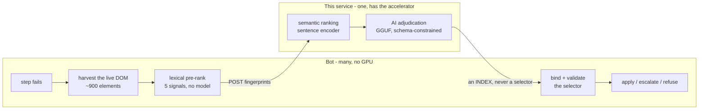

# Self-Healing UI Agent

**Locator repair for UI automation, as a service.** When an automated process
stops because the front end it drives has been redesigned, this decides which
element the step *meant* and hands back an answer the bot can act on — inline,
while the process is still running.


---

## The problem

Every UI automation is built on selectors, and every selector is a bet that a
front-end team will not rename anything. They do. A component library goes
from `pd19-product-card` to `pd21-product-card`, a `data-testid` is dropped,
a wrapper `div` appears — and a process that ran for two years stops at 2 a.m.

Nothing is wrong with the logic. The button is still on the screen, in the
same place, with the same label. Only its address changed.

This service answers the question a human would answer in four seconds:
**given what this step was trying to do, which element on the page is it now?**

## How it decides

Repair is not pattern matching, and it is not "ask a model". It is evidence,
weighted, with a language model as one voice among several:

| signal | weight | what it knows |
| --- | --- | --- |
| identity | 0.24 | survival of the normalised id / class name |
| attributes | 0.18 | id, name, class and `data-*` token overlap |
| text | 0.18 | visible and accessible text similarity |
| semantic | 0.14 | sentence-embedding distance from the step's stated intent |
| structure | 0.10 | DOM path and ancestor chain |
| tag | 0.08 | tag and ARIA-role compatibility |
| geometry | 0.08 | on-screen position and size |

A local GGUF model then adjudicates the shortlist and its verdict is fused in
at a weight of 0.35. It is deliberately not the decision-maker — see
[Guardrails](#guardrails).

**Digit runs are collapsed before comparison**, so `pd19` and `pd21` are the
same token and `v3` and `v4` are the same component. That single rule is the
highest-yield signal against real redesigns, because versioned class names are
how most front ends actually break.

## Architecture

The pipeline is split at the point where the hardware requirements diverge.
Everything that needs a **browser** runs on the bot; everything that needs an
**accelerator** runs here. This repository is the second half.



One accelerated host serves an entire fleet. A bot needs no GPU, no weights
and no model runtime — it posts element fingerprints and gets back a number.

**What crosses the wire** is tag, attributes, label text, geometry and the
ancestor chain, for the shortlist the bot already believes in. Not the page,
not the DOM, not a screenshot, and never the values being typed. A repair
request is tens of kilobytes.

## Guardrails

The design choices that make this safe to put in front of a production robot,
each of which exists because the alternative fails badly:

**The model never invents a selector.** It returns an *index* into a list of
elements harvested from the live DOM. A hallucinated selector is not a
possible output.

**The service never returns a selector at all.** Only the machine holding the
browser can prove a selector resolves, so binding stays there. The response
carries an index, a confidence and a rationale.

**Absent signals score `None`, never zero.** A signal with no evidence is
dropped from the weighted mean rather than counted as disagreement —
otherwise a first-time repair is punished for having no history.

**Confidence is banded, and the bands are defined once.** Above
`auto_apply_threshold` a repair is applied; between that and
`review_threshold` a human is asked; below it the agent refuses and the step
fails loudly. Refusing to guess is a feature.

**Everything fails open.** An unreachable service, a missing model or
malformed output degrades to "no opinion" and the deterministic signals stand.
An automation must never stop because a healing service is down.

## Quick start

```bash
git clone https://github.com/AnshikaGovil/self-healing-ui-agent.git
cd self-healing-ui-agent

python -m venv .venv
.venv\Scripts\activate                # Linux/macOS: source .venv/bin/activate
pip install -r requirements.txt
```

Provision a model — any instruction-tuned GGUF that llama.cpp can load. A 3-8B
model at 4-bit is the right size band; the task is choosing an index from a
shortlist of eight, not writing code:

```bash
python scripts/provision_model.py --list      # find one already on this machine
python scripts/provision_model.py --prefer 4b
```

Run it. `--gpu-layers` is the only thing that differs between the two
deployments:

```bash
# CPU - works anywhere, nothing further to install
python -m healing_service --host 0.0.0.0 --port 8077 --gpu-layers 0 --context 4096

# GPU - offload every layer that fits
python -m healing_service --host 0.0.0.0 --port 8077 --gpu-layers -1 --context 4096

curl http://localhost:8077/v1/health
```

The service reports the device it *actually* got, rather than the one it hoped
for — a fleet that has silently dropped to CPU should be visible, not a
mystery:

```json
{ "ready": true,
  "ai": { "loaded": true, "device": "gpu", "gpu_offload_supported": true } }
```

### Running on CPU

CPU is a supported deployment, not a degraded one. `pip install -r
requirements.txt` already installs a CPU-only llama.cpp build, so the steps
above are complete as they stand — no driver to match, no CUDA toolkit, no
further downloads:

```bash
python -m healing_service --port 8077 --gpu-layers 0 --context 4096
```

`--gpu-layers 0` forces it explicitly, which is worth doing even on a machine
that has a GPU when you want a like-for-like comparison. Health then reads:

```json
{ "ready": true,
  "ai": { "loaded": true, "device": "cpu",
          "gpu_offload_supported": true, "gpu_layers_requested": 0 } }
```

Those last two fields answer different questions, and the distinction is the
point of reporting both. `gpu_offload_supported` describes the **build** -
whether this llama.cpp could offload if asked. `device` describes this
**run**. Seeing `true` and `cpu` together means a capable build was told to
stay on the CPU, which is what `--gpu-layers 0` does. Seeing `false` means the
installed wheel has no GPU support compiled in at all, which is the case a
fleet needs to notice.

Measured with a 4B model at 4-bit: **about 8 s per repair on CPU against
about 6 s on a 4 GB GPU.** A repair only happens when a selector has already
broken, so that difference rarely decides anything — and the deterministic
signals, which do most of the work, cost the same either way.

Two settings matter more on CPU than they look:

* **`--context 4096`, or lower.** The adjudication prompt is a few hundred
  tokens. A larger context buys nothing and costs memory and
  prompt-processing time on every request.
* **`--no-ai` is a supported mode**, not a broken one. It serves the six
  deterministic signals and the semantic ranking with no language model at
  all, which is the fastest configuration available. Confidence falls, so
  more repairs land in the review band and fewer are applied autonomously —
  that is the honest trade, and the bands are what keep it safe.

To check what a given environment is actually capable of before starting the
service:

```bash
python scripts/provision_gpu.py --check
```

### Getting onto a GPU

`pip install llama-cpp-python` gives a CPU-only build however good your driver
is, so a fresh environment always starts on CPU. One command fixes that, into
whichever environment runs it:

```bash
python scripts/provision_gpu.py --check     # report, change nothing
python scripts/provision_gpu.py             # install a CUDA build + cuBLAS
```

It installs a CUDA-capable wheel *and* the cuBLAS runtime that wheel links
against but does not bundle. That second part is the one that costs people an
afternoon: without it the backend fails to load with an error naming
`ggml-cuda.dll` rather than the library it could not find, and the offload
probe simply reports `False`.

## API

| endpoint | purpose |
| --- | --- |
| `POST /v1/adjudicate` | rank a candidate pool and choose one — returns an index |
| `GET /v1/js` | the in-page JavaScript a thin client executes, plus a content hash |
| `GET /v1/health` | readiness, device, model, uptime, requests served |
| `GET /docs` | generated OpenAPI reference |

Set `BIS_API_KEY` (or `--api-key`) to require an `X-API-Key` header. Unset
means open, which is right on localhost and wrong on a network — the service
logs a warning at startup either way.

`/v1/js` is what keeps a client thin. The DOM-harvesting JavaScript is the
component most likely to need work as real sites change, so it is **served
rather than embedded**: improving it is a service restart instead of a
redeploy to every bot in the fleet. Clients cache it against the content hash.

## Measured

Graded on a benchmark built from live sites — BBC, The Guardian, Flipkart and
Wikipedia, in both CSS and XPath — where real selectors are perturbed the way
a release leaves them and a repair is scored by resolving it and the answer key
in the same page and **comparing DOM nodes by identity**. "Healed" and "healed
to the right element" are different questions, and only the second one matters:

| | |
| --- | --- |
| correct element | **86.9%** of 84 locators |
| latency per repair, GPU | ~6 s |
| latency per repair, CPU | ~8 s |

Two findings from that data worth stating, because both are counter-intuitive:

**The language model has never overridden the ranker.** Across every recorded
repair: 61 agreements, zero overrides. The model is not selecting the element —
the deterministic signals are. What it contributes is *confidence*, and the
scores are systematically under-confident without it.

**Which means the obvious optimisation is wrong.** Dropping the model to save
the round trip would leave correct repairs scoring below the apply threshold,
so they would stop being applied and start interrupting a human — a worse
outcome than the latency it saves.

## Tests

```bash
python tests/test_similarity.py    # 29 - the ranking signals, CSS and XPath
python tests/test_service.py       # 13 - API contract, decision policy, wire schema
```

Both are **offline by design**: no browser, no service, no model, no network.
The FastAPI app runs in-process with the adjudicator disabled. That is
deliberate — the whole point of a deterministic layer is that it holds up when
none of the rest is available, and a suite that quietly needed a GPU would stop
proving it.

One of them enforces that `bis_core` imports nothing outside the standard
library. Every bot in a fleet installs that package, and the moment it reaches
for torch, that cost lands on every automation host for no reason.

## Layout

```
bis_core/            the shared core - pure standard library, no dependencies
  config.py          every tunable, and the confidence-band policy
  descriptors.py     LocatorSpec / ElementDescriptor, tokenising, digit collapsing
  similarity.py      the six deterministic signals, selector mining
  adjudicator.py     the wire contract, and local / remote implementations
  js_harvest.py      in-page JS: fingerprinting, selector proposal, probes
  runtime.py         the slots the accelerator half plugs into

healing_service/     the API - this is what runs on the accelerated host
  app.py             FastAPI application and CLI
  schemas.py         request and response models
  inference.py       GGUF runtime, schema-constrained decoding
  embeddings.py      sentence encoder - lazy, offline, fail-open

scripts/             provision_model.py, provision_gpu.py
tests/               two offline suites
```

`bis_core` declares two slots — an encoder and a model — and `healing_service`
fills them on import. The dependency runs one way only, which is what lets the
core stay dependency-free and installable anywhere.

## Licence

MIT.
